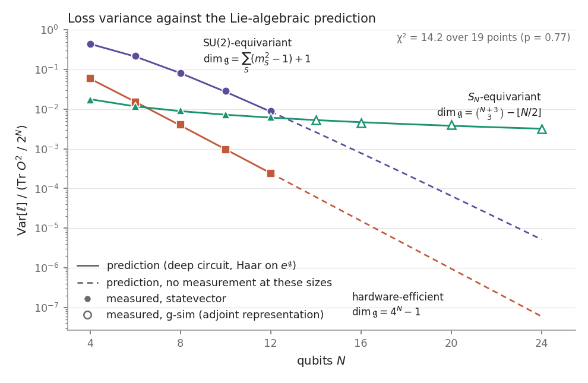
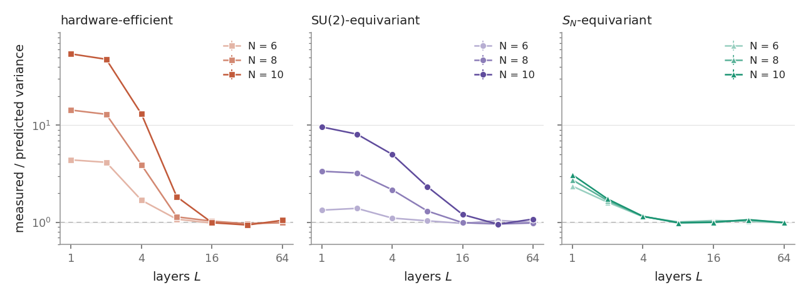
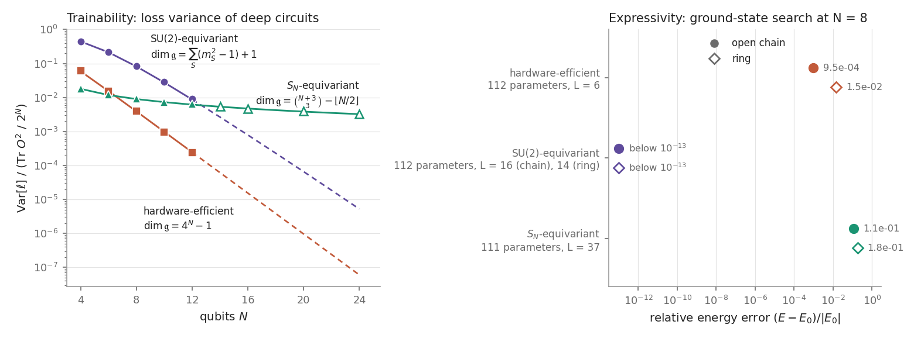

# geometric-qml-equivariance

Variational circuits built from symmetric generators, their dynamical Lie algebras, and what the algebra predicts about trainability.

[](https://github.com/Jaspersands/geometric-qml-equivariance/actions/workflows/ci.yml)
[](LICENSE)

For a deep circuit, the variance of the loss over random parameters is fixed by the Lie algebra that its gates generate [1, 2]. This package computes that prediction for three circuit families and measures the variance by sampling. The two agree within sampling error from 4 to 12 qubits, and to 24 qubits for the permutation-equivariant circuit, which can be simulated in its adjoint representation. The permutation-equivariant circuit's variance decays only polynomially, but up to 12 qubits the exchange circuit has the larger variance, each on its own loss; by the formula the order changes between 12 and 14 qubits. The permutation-equivariant circuit also cannot change the energy of a Heisenberg model, because its generators conserve that energy. The exchange circuit reaches the ground state, and its variance falls with the dimension of the singlet sector.

[Interactive page](https://qml.jaspersands.com/): an eight-qubit statevector simulator in the browser, with the sampling and Lie algebra closures running in a background worker.

## The variance follows the Lie algebra

Take a loss $\ell(\theta) = \mathrm{Tr}[U(\theta)\rho\, U(\theta)^\dagger O]$. If the circuit is deep enough that $U(\theta)$ is Haar distributed on the group $e^{\mathfrak g}$ generated by its gates, if $O \in i\mathfrak g$ (or $\rho \in i\mathfrak g$), and if $\mathfrak g = \mathfrak g_1 \oplus \dots \oplus \mathfrak g_{k-1} \oplus \mathfrak z$ splits into simple ideals and a centre, then [1, Theorem 1]

$$\mathrm{Var}[\ell] = \sum_{j=1}^{k-1} \frac{P_{\mathfrak g_j}(\rho)\, P_{\mathfrak g_j}(O)}{\dim \mathfrak g_j}, \qquad \mathbb E[\ell] = \frac{\mathrm{Tr}\,\rho\,\mathrm{Tr}\,O}{d} + \mathrm{Tr}[\rho_{\mathfrak z}\, O_{\mathfrak z}],$$

with $d = 2^N$. The first term of the mean comes from the identity component of $O$; it is zero for the traceless observables used here.

The $\mathfrak g$-purity $P_{\mathfrak g_j}(H) = \mathrm{Tr}[H_{\mathfrak g_j}^2]$ is the squared Hilbert–Schmidt norm of the orthogonal projection of $H$ onto $\mathfrak g_j$; with an orthonormal Hermitian basis $\{B_a\}$ of $i\mathfrak g_j$ it is $\sum_a \mathrm{Tr}[B_a H]^2$. For $\mathfrak g = \mathfrak{su}(d)$ this is the usual Haar value $(\mathrm{Tr}\,\rho^2 - 1/d)(\mathrm{Tr}\,O^2 - (\mathrm{Tr}\,O)^2/d)/(d^2 - 1)$.

The three circuits and their algebras, with $m_S$ the multiplicity of total spin $S$ and $C$ the Casimir $S^2$. The two symmetric families are examples of circuits built from symmetric generators [8]:

| Circuit | Generators | $\mathfrak g$ | Simple ideals act on |
|---|---|---|---|
| hardware-efficient | RY, RZ on every qubit, CNOT ladder | $\mathfrak{su}(2^N)$ | the whole space |
| SU(2)-equivariant | $X_iX_j + Y_iY_j + Z_iZ_j$ on chain bonds, one angle per gate | $\bigoplus_S \mathfrak{su}(m_S) \oplus \mathbb R\,C$ | the multiplicity spaces, dimension $m_S$ |
| $S_N$-equivariant [3] | $\sum_k X_k$, $\sum_k Y_k$, $\sum_{k<l} Z_kZ_l$ | $\bigoplus_S \mathfrak{su}(2S+1) \oplus \mathbb R\,C$ [4] | the spin spaces, dimension $2S+1$ |

The two symmetric cases are dual under Schur–Weyl duality, $(\mathbb C^2)^{\otimes N} = \bigoplus_S V_S \otimes W_S$. The purities are partial traces of $\Pi_S X \Pi_S$ over one factor or the other, computed in a basis $|S, M, a\rangle$ built from highest-weight vectors and the lowering operator, so the cost is set by the $S_z$ sectors (924 states at $N = 12$) rather than by $4^N$. The same numbers also come out of a general route that orthonormalises a dense DLA basis, finds the centre as the kernel of the adjoint map, and splits the rest into simple ideals; the tests check that the two agree.

Inputs and observables, chosen so that $O \in i\mathfrak g$:

- hardware-efficient and SU(2)-equivariant: the singlet product state, and $O = \sum_i \sigma_i \cdot \sigma_{i+1}$ on the open chain (a sum of the exchange generators);
- $S_N$-equivariant: the Néel state $|0101\dots\rangle$, and $O = \sum_{i<j} X_iX_j$ (the observable of [3]; a global rotation of the generator $\sum Z_kZ_l$). The singlet product state cannot be used here: it lies in the $S = 0$ block, where an $S_N$-symmetric circuit acts as a phase, so the loss is constant.

Angles are drawn uniformly from $[0, 2\pi)$, 2000 parameter vectors per point. Measured means the sample variance of exact expectation values at those parameters; there is no shot noise. The circuits run as NumPy statevectors up to $N = 12$, and the $S_N$ circuit runs in its adjoint representation (g-sim [6]) at $N = 14$ to $24$.



The variance is divided by $\mathrm{Tr}\,O^2/2^N$, the observable's mean square, so the three families share an axis. Raw values:

| N | L | hardware-efficient, predicted | measured | SU(2), predicted | measured | L | $S_N$, predicted | measured |
|---|---|---|---|---|---|---|---|---|
| 4 | 16 | 0.529 | 0.547 ± 0.018 | 4.000 | 4.006 ± 0.080 | 32 | 0.1074 | 0.1055 ± 0.0030 |
| 6 | 24 | 0.2308 | 0.2270 ± 0.0071 | 3.20 | 3.31 ± 0.10 | 32 | 0.1767 | 0.1783 ± 0.0052 |
| 8 | 32 | 0.0817 | 0.0842 ± 0.0027 | 1.714 | 1.748 ± 0.056 | 32 | 0.2507 | 0.2573 ± 0.0078 |
| 10 | 40 | 0.02634 | 0.02586 ± 0.00083 | 0.744 | 0.790 ± 0.025 | 32 | 0.3273 | 0.3289 ± 0.0098 |
| 12 | 48 | 0.00805 | 0.00784 ± 0.00025 | 0.2871 | 0.2973 ± 0.0093 | 32 | 0.405 | 0.416 ± 0.013 |
| 14 | | | | | | 32 | 0.485 | 0.490 ± 0.015 (g-sim) |
| 16 | | | | | | 32 | 0.565 | 0.549 ± 0.017 (g-sim) |
| 20 | | | | | | 32 | 0.727 | 0.761 ± 0.024 (g-sim) |
| 24 | | | | | | 32 | 0.891 | 0.881 ± 0.028 (g-sim) |

Errors are one standard error of the sample variance, from the fourth central moment. Over all 19 points, $\chi^2 = \sum z^2 = 14.2$ with $z$ = (measured − predicted)/error, a p-value of 0.77; the largest $|z|$ is 1.8. The five SU(2) points all lie above the prediction, which on its own would happen by chance about one time in 32. An 8000-sample rerun at $N = 6, 8, 10$ gives measured/predicted ratios of 1.018 ± 0.016, 1.003 ± 0.017 and 1.005 ± 0.016 at $L = 4N$, and 0.979, 0.993 and 1.000 at $L = 16N$, so there is no detectable depth bias at $L = 4N$. From $N = 14$ on, the $S_N$ points and the line both come from g-sim, so they share its inputs; the tests check g-sim against the statevector at $N = 14$ (they agree to within $5 \times 10^{-13}$) and its prediction against the Schur-basis route at $N = 14$.

The formula is for the Haar ensemble on $e^{\mathfrak g}$. A circuit with independent random angles approaches that ensemble as its depth grows:



The scans were run at $N = 6$, 8 and 10 with $L = 1, 2, 4, \dots, 64$. The first depth within two standard errors of the prediction is $L$ = 8, 16, 16 for the hardware-efficient circuit and 8, 16, 32 for the exchange circuit, at most $3.2N$; the comparison above uses $L = 4N$ ($N = 12$ was not scanned). Shallower circuits have a larger variance, by a factor of 54 for a single hardware-efficient layer at $N = 10$. The $S_N$ circuit is within two standard errors from $L = 8$ at all three sizes, and the comparison uses $L = 32$.

Two closed forms come out of the formula. With the singlet input only the $S = 0$ ideal $\mathfrak{su}(C_{N/2})$ contributes, and the prediction reduces to the Haar variance inside the singlet sector, $\mathrm{Var}_{\mathrm{spec}}(H_0)/(C_{N/2} + 1)$, where $H_0$ is $H$ restricted to that sector and $C_{N/2}$ is a Catalan number. The mean comes from the centre alone and equals $-3$ for every $N$. The tests also cover inputs and observables that reach several ideals at once: the Néel state for the exchange circuit, and a single bond $\sigma_1 \cdot \sigma_2$ as the observable with the singlet and Néel inputs ($N = 6$, $L = 24$, 4000 samples each). Run `geometric-qml variance-theory --ansatz su2 --qubits 8` to repeat one comparison.

## Trainability against expressivity



The three algebras give three scalings of the normalised variance at depth:

- hardware-efficient, $\dim\mathfrak g = 4^N - 1$: exactly $1/(2^N + 1)$ for a pure input, whatever the observable. This is the 2-design value behind the first barren-plateau result [9];
- SU(2)-equivariant, $\dim\mathfrak g = \sum_S (m_S^2 - 1) + 1$ (1426 at $N = 8$): with the singlet input, $\mathrm{Var}_{\mathrm{spec}}(H_0)/(C_{N/2} + 1)$ divided by $3(N-1)$. It decays roughly as $1/C_{N/2}$, the inverse dimension of the singlet sector: still exponential, but slower;
- $S_N$-equivariant, $\dim\mathfrak g = \binom{N+3}{3} - \lfloor N/2 \rfloor$ (161 at $N = 8$, 2913 at $N = 24$): it decays polynomially, roughly as $1/N$.

Beyond $N = 12$ the hardware-efficient and SU(2) lines are the formula alone (dashed). The SU(2) line uses $\mathrm{Tr}_{S=0}X = \mathrm{Tr}_{S_z=0}X - \mathrm{Tr}_{S_z=1}X$ for SU(2)-invariant $X$, which holds because every multiplet with $S \ge 1$ has one state in each of the two sectors. Applied to $H$ and $H^2$ it needs only the $S_z$ sectors, $\binom{N}{N/2}$ states, and reaches $N = 24$; at $N \le 12$ it agrees with the Schur-basis prediction to $10^{-15}$.

| N | 4 | 8 | 12 | 14 | 16 | 20 | 24 |
|---|---|---|---|---|---|---|---|
| SU(2), singlet input, $O = H$ | 0.444 | 0.0816 | 0.0087 | 0.0026 | $7.8 \times 10^{-4}$ | $6.5 \times 10^{-5}$ | $5.2 \times 10^{-6}$ |
| $S_N$, Néel input, $O = \sum X_iX_j$ | 0.0179 | 0.0090 | 0.0061 | 0.0053 | 0.0047 | 0.0038 | 0.0032 |

The two symmetric circuits are not scored on the same loss, so this is not a like-for-like comparison. Up to $N = 12$, where both are measured, the exchange circuit has the larger normalised variance. The two lines cross between $N = 12$ and $14$, and the $S_N$ circuit's advantage exists only beyond that, where the SU(2) value has not been measured.

Expressivity is tested on a third loss, the Heisenberg energy. A ground-state search for the eight-qubit model, $H = \sum_{\langle ij\rangle} \sigma_i \cdot \sigma_j$, with at most 112 parameters per circuit, starts every circuit from the singlet product state ($E = -12$) and keeps the best of four L-BFGS runs:

| Circuit | Parameters | Layers | Chain: $E - E_0$ | Fidelity | Ring: $E - E_0$ | Fidelity |
|---|---|---|---|---|---|---|
| hardware-efficient | 112 | 6 | $1.3 \times 10^{-2}$ | 0.9983 | 0.21 | 0.9798 |
| SU(2)-equivariant | 112 | 16 (chain), 14 (ring) | below $10^{-13}$ | 1.0000 | below $10^{-13}$ | 1.0000 |
| $S_N$-equivariant | 111 | 37 | 1.4997 | 0.7649 | 2.6044 | 0.5043 |

Here $E_0 = -13.49973$ for the open chain and $-14.60437$ for the ring.

The $S_N$ circuit does not move, and that is a symmetry mismatch rather than a measurement of its expressivity. Its generators are collective spin operators, $\sum_k X_k = 2S_x$, $\sum_k Y_k = 2S_y$ and $\sum_{k<l} Z_kZ_l = 2S_z^2 - N/2$, so they commute with any SU(2)-invariant $H$, and $U^\dagger H U = H$ for every circuit built from them. The energy is a conserved quantity of the circuit: its gradient is zero everywhere and its variance over random parameters is exactly zero. Over 200 random circuits the energy changes by less than $10^{-12}$, for both lattices and for both the singlet and the Néel input. The same holds for any $S_N$-equivariant circuit built from these collective generators, on any graph. The overlap with the ground state is fixed too, because the ground state lies in the $S = 0$ block, where the circuit is a phase. For the same reason a circuit with both symmetries is trivial: an operator invariant under $S_N$ and SU(2) acts as a scalar on each spin block, so it is a function of the Casimir.

The exchange circuit reaches the ground state of both lattices to machine precision. The price is the variance above, which falls with the size of the singlet sector.

The $S_N$ circuit is the one whose variance decays slowly, and it is also cheap to simulate classically: its loss evolves in a space of dimension $\dim \mathfrak g$, which is how the points at $N = 14$ to $24$ were obtained. Cerezo et al. [5] argue that this is the general pattern: the structure that provably removes barren plateaus usually confines the computation to a small space, and that also makes the loss classically simulable.

## The Lie algebra

Larocca et al. [7] related the dimension of the DLA to barren plateaus. By Schur–Weyl duality the exchange operators generate the commutant of SU(2) as an associative algebra. Their Lie closure is a separate result: it is $\bigoplus_S \mathfrak{su}(m_S)$ plus one central element [10], so

$$\dim \mathfrak g = \sum_S (m_S^2 - 1) + 1, \qquad m_S = \binom{N}{N/2 - S} - \binom{N}{N/2 - S - 1}.$$

The closure code checks this up to $N = 8$: it gives 1, 12, 129 and 1426 for chains of 2, 4, 6 and 8 qubits, matching the formula, while hardware-efficient circuits generate all of $\mathfrak{su}(2^N)$ (15, 63, 255). Because $m_S$ grows like a Catalan number, this algebra is exponentially smaller than $\mathfrak{su}(2^N)$ but not polynomial in $N$.

The $S_N$ commutant is $\bigoplus_S \mathrm{End}(V_S)$, of dimension $\sum_S (2S+1)^2 = \binom{N+3}{3}$, the tetrahedral number of [3]. One- and two-body generators give $\mathfrak{su}(2S+1)$ on every spin block but only one central direction [4], so $\dim\mathfrak g = \binom{N+3}{3} - \lfloor N/2 \rfloor$: 9, 33, 81, 161, 281, 449 for $N$ = 2, 4, …, 12. The closure on the spin blocks matches this for every $N$ from 2 to 24 and at $N = 28$ (the tests run $N = 2$ to 16), and the dense closure on $4^N$-dimensional operators matches it for $N = 2$ to 4. The spin-block closure runs over the integers modulo two primes near $2^{20}$, in the basis $S_-^k|S, S\rangle$ where $S_+$, $S_-$ and $2S_z^2 - N/2$ are integer matrices, so it needs no rank tolerance. A floating-point closure needs one, and round-off grows over the roughly $2N$ rounds this closure takes: with the generators scaled to unit norm it is right up to $N = 16$ and over-counts from $N = 17$. Both versions raise an error if the count exceeds $\binom{N+3}{3}$.

The closure is computed efficiently in two ways. Because the algebra is spanned by nested commutators $[g_1,[g_2,\dots g_k]]$, each round commutes only the generators with the newest elements: $n_g D$ commutators instead of $D^2$. For symmetric generators it can also run on the Schur blocks: 1 430 numbers per element at $N = 8$ instead of 65 536 for the exchange circuit, and spin matrices of size at most $N + 1$ for the $S_N$ circuit.

## Modules

| Module | Contents |
|---|---|
| `models` | Lattices (chain, ring, grid, triangular ladder, and kagome on $L_x \times L_y$ unit cells), Heisenberg models built as sparse matrices, SU(2) generators, spin multiplicities |
| `ansatz` | Equivariant (exchange), hardware-efficient, QAOA and $S_N$-equivariant circuits, each with a PennyLane circuit, its generators and a NumPy unitary |
| `dla` | Lie algebra closure (generator-frontier algorithm, batched orthonormalisation, and an exact closure mod $p$ for the $S_N$ circuit), the SU(2)- and $S_N$-reduced representations, both closed-form dimensions |
| `variance_theory` | 𝔤-purities from a dense DLA basis or from the Schur blocks, the deep-circuit prediction of mean and variance, the singlet-input prediction from $S_z$-sector traces, sampled variances with standard errors, depth scans |
| `statevector` | NumPy statevector simulation of the circuit families, batched over parameter samples, with adjoint gradients |
| `gsim` | Simulation in the adjoint representation for observables inside the DLA; the $S_N$ circuit at any $N$ |
| `expressivity` | Ground-state searches at a fixed parameter budget; the energy-invariance check for the $S_N$ circuit |
| `barren_plateau` | Gradient variance at random parameters and its scaling with $N$ (PennyLane), at fixed depth or depth $L = N$ |
| `vqe` | Variational ground-state search with a singlet-purity diagnostic |
| `fermi_hubbard` | Sparse Jordan–Wigner Fermi–Hubbard chain, spin and η-pairing SU(2) generators, Lanczos ground states in fixed $(N, S_z)$ sectors |
| `qgnn` | A graph network whose layers are exponentials of the graph Heisenberg Hamiltonian; exact, or Trotterised into native exchange gates |
| `sycamore_transpile` | Exchange gates as FSim plus CNOT·Rz·CNOT, with a snake placement that puts every chain bond on a coupler |
| `export_openfermion` | Hamiltonians as JSON, OpenFermion and Qiskit term lists |
| `cli` | `geometric-qml variance-theory | variance | dla | sectors | transpile | vqe | benchmark` |

## Examples

```python
import numpy as np
from geometric_qml import (
    HeisenbergSpinChain, FermiHubbardChain, compare_prediction, permutation_equivariant_simulator,
    equivariant_dla_dimension_formula, permutation_dla_dimension_formula,
)
from geometric_qml.dla import equivariant_dla_dimension_by_closure, permutation_dla_dimension_by_closure
from geometric_qml.gsim import permutation_equivariant_sequence
from geometric_qml.qgnn import QuantumGraphNeuralNetwork

# Deep-circuit loss variance: prediction against 2000 random circuits (exchange gates, 8 qubits, 32 layers)
r = compare_prediction("su2", n_qubits=8, depth=32, n_samples=2000, seed=0)
print(r["predicted"], r["measured"], r["measured_se"])                                   # 1.7143, 1.717 ± 0.053

# Lie algebra dimensions against the closed forms
print(equivariant_dla_dimension_by_closure([(i, i + 1) for i in range(7)], 8)["dla_dimension"],
      equivariant_dla_dimension_formula(8))                                               # 1426 1426
print(permutation_dla_dimension_by_closure(12)["dla_dimension"], permutation_dla_dimension_formula(12))  # 449 449

# The S_N circuit at 24 qubits, simulated in its adjoint representation
sim = permutation_equivariant_simulator(24)
x = sim.expectation(permutation_equivariant_sequence(32), np.random.default_rng(0).uniform(0, 2 * np.pi, (500, 96)))
print(sim.predicted_variance(), x.var(ddof=1))                                            # 0.891, about 0.9

# The 12-site kagome torus (every site has four neighbours)
print(HeisenbergSpinChain(12, lattice_type="kagome", periodic_boundary=True).exact_ground_state()[0] / 48)  # −0.45374

# Fermi–Hubbard, 8 sites at half filling (16 qubits, sparse)
print(FermiHubbardChain(n_sites=8, on_site_u=4.0).ground_energy(n_particles=8, sz=0.0))   # −4.23581

# A graph-network layer compiled to native exchange gates
ring = np.roll(np.eye(6), 1, axis=1); ring = ring + ring.T
q = QuantumGraphNeuralNetwork(ring, n_layers=2, trotter_steps=8)
print(q.su2_equivariance_error([0.3, 0.1, 0.5, 0.2]), q.equivariance_error([0.3, 0.1, 0.5, 0.2], [1, 2, 3, 4, 5, 0]))
```

```bash
geometric-qml variance-theory --ansatz su2 --qubits 8      # also: --ansatz hea, --ansatz sn
geometric-qml dla --ansatz sn --qubits 10
geometric-qml sectors --qubits 8
python benchmarks/make_figures.py                         # figures/ and figures/results.json, about ten minutes
python benchmarks/make_figures.py --plot-only             # redraw; --lines recomputes the prediction lines, --recheck adds the 8000-sample rerun
```

## Limitations

- Sizes are small: statevectors up to 12 qubits for all three circuits, and 24 qubits for the $S_N$ circuit through g-sim. Beyond 12 qubits the hardware-efficient and SU(2) lines are the formula, not measurements, and so is the crossover between the SU(2) and $S_N$ lines.
- The trainability comparison uses a different loss for each symmetric circuit (singlet input and $H$ for the exchange circuit, Néel input and $\sum X_iX_j$ for the $S_N$ circuit), and the expressivity test uses a third.
- The prediction is for the Haar ensemble on $e^{\mathfrak g}$. It describes a circuit with independent uniform angles only once the circuit is deep enough, here $L = 4N$ (32 layers for $S_N$). Shallow circuits, correlated or shared angles, and small-angle initialisations are not covered. The weight-shared circuit in `barren_plateau` is not compared with the formula.
- The formula needs $O \in i\mathfrak g$ or $\rho \in i\mathfrak g$. It has been checked for the singlet product and Néel states, with the open-chain Heisenberg Hamiltonian and a single bond as observables for the exchange circuit, and $\sum_{i<j} X_iX_j$ for the $S_N$ circuit. It does not apply to the chain Hamiltonian under the $S_N$ circuit, where neither condition holds.
- This is the variance of the loss, not of its gradient.
- The expressivity numbers come from one optimiser (L-BFGS, best of four random starts) at one budget. They show what that search reached, not what each circuit could reach in principle. The exception is the $S_N$ result, which follows from the symmetry. The four hardware-efficient runs on the chain stopped at the iteration cap of 2000; with a cap of 10 000 three of them converge and the best error moves from 0.012859 to 0.012851. The ring runs are unchanged.

## Notes

- The gradient study in `barren_plateau` uses a weight-shared exchange circuit whose single angle multiplies a sum over $N - 1$ bonds, so it reports the variance per bond. Its fitted slopes (about −0.72 per qubit for hardware-efficient, −0.38 for equivariant) are kept for reference; the comparison with theory above supersedes them.
- At $N = 2$ the exchange circuit's cost is constant, because the singlet is the only $S = 0$ state.
- Trotterisation keeps SU(2) equivariance exact, because every native exchange gate commutes with total spin. Permutation equivariance becomes approximate, with an error falling as $1/r^2$ in the number of Trotter steps; `equivariance_error` measures it.
- The Sycamore transpiler uses FSim gates with arbitrary angles. Hardware exposes one calibrated angle; the companion `cirq-fsim-compiler` handles that case.

## Install

```bash
pip install -e ".[dev]"
pytest                                             # 96 tests, about 50 s; -m "not slow" skips the four longer ones (about 25 s)
python benchmarks/make_figures.py
```

Models, the Lie algebra code, the variance prediction, the statevector simulator, g-sim and Fermi–Hubbard need only NumPy and SciPy. PennyLane is used for the PennyLane circuits, the gradient study and the original VQE, and Cirq for transpilation. The notebook [`notebooks/02_su2_equivariant_qnn_barren_plateaus.ipynb`](notebooks/02_su2_equivariant_qnn_barren_plateaus.ipynb) has executed outputs. Changes are listed in [CHANGELOG.md](CHANGELOG.md).

## References

1. M. Ragone, B. N. Bakalov, F. Sauvage, A. F. Kemper, C. Ortiz Marrero, M. Larocca and M. Cerezo, A Lie algebraic theory of barren plateaus for deep parameterized quantum circuits, Nat. Commun. 15, 7172 (2024), [arXiv:2309.09342](https://arxiv.org/abs/2309.09342).
2. E. Fontana, D. Herman, S. Chakrabarti, N. Kumar, R. Yalovetzky, J. Heredge, S. H. Sureshbabu and M. Pistoia, Characterizing barren plateaus in quantum ansätze with the adjoint representation, Nat. Commun. 15, 7171 (2024), [arXiv:2309.07902](https://arxiv.org/abs/2309.07902).
3. L. Schatzki, M. Larocca, Q. T. Nguyen, F. Sauvage and M. Cerezo, Theoretical guarantees for permutation-equivariant quantum neural networks, npj Quantum Inf. 10, 12 (2024), [arXiv:2210.09974](https://arxiv.org/abs/2210.09974).
4. S. Kazi, M. Larocca and M. Cerezo, On the universality of $S_n$-equivariant $k$-body gates, New J. Phys. 26, 053030 (2024), [arXiv:2303.00728](https://arxiv.org/abs/2303.00728).
5. M. Cerezo, M. Larocca, D. García-Martín, N. L. Diaz, P. Braccia, E. Fontana, M. S. Rudolph, P. Bermejo, A. Ijaz, S. Thanasilp, E. R. Anschuetz and Z. Holmes, Does provable absence of barren plateaus imply classical simulability?, Nat. Commun. 16, 7907 (2025), [arXiv:2312.09121](https://arxiv.org/abs/2312.09121).
6. M. L. Goh, M. Larocca, L. Cincio, M. Cerezo and F. Sauvage, Lie-algebraic classical simulations for quantum computing, Phys. Rev. Research 7, 033266 (2025), [arXiv:2308.01432](https://arxiv.org/abs/2308.01432).
7. M. Larocca, P. Czarnik, K. Sharma, G. Muraleedharan, P. J. Coles and M. Cerezo, Diagnosing barren plateaus with tools from quantum optimal control, Quantum 6, 824 (2022), [arXiv:2105.14377](https://arxiv.org/abs/2105.14377).
8. J. J. Meyer, M. Mularski, E. Gil-Fuster, A. A. Mele, F. Arzani, A. Wilms and J. Eisert, Exploiting symmetry in variational quantum machine learning, PRX Quantum 4, 010328 (2023), [arXiv:2205.06217](https://arxiv.org/abs/2205.06217).
9. J. R. McClean, S. Boixo, V. N. Smelyanskiy, R. Babbush and H. Neven, Barren plateaus in quantum neural network training landscapes, Nat. Commun. 9, 4812 (2018), [arXiv:1803.11173](https://arxiv.org/abs/1803.11173).
10. I. Marvian, H. Liu and A. Hulse, Rotationally invariant circuits: universality with the exchange interaction and two ancilla qubits, Phys. Rev. Lett. 132, 130201 (2024), [arXiv:2202.01963](https://arxiv.org/abs/2202.01963).

Apache-2.0 · Jasper Sands
